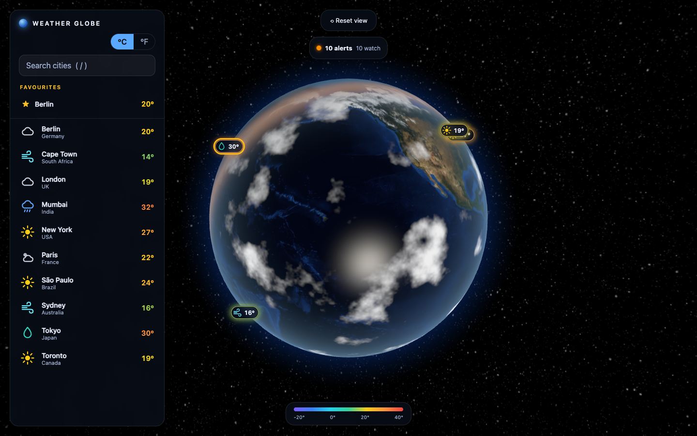
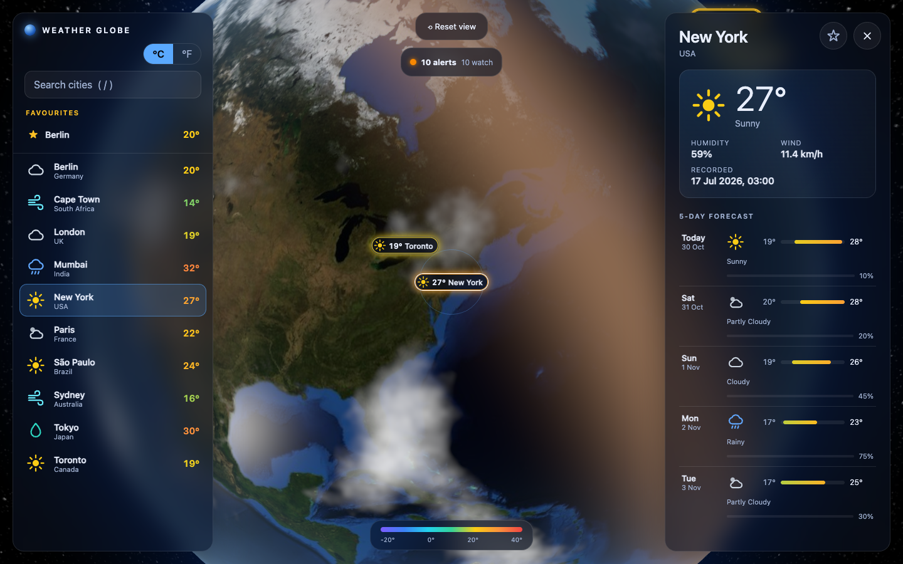
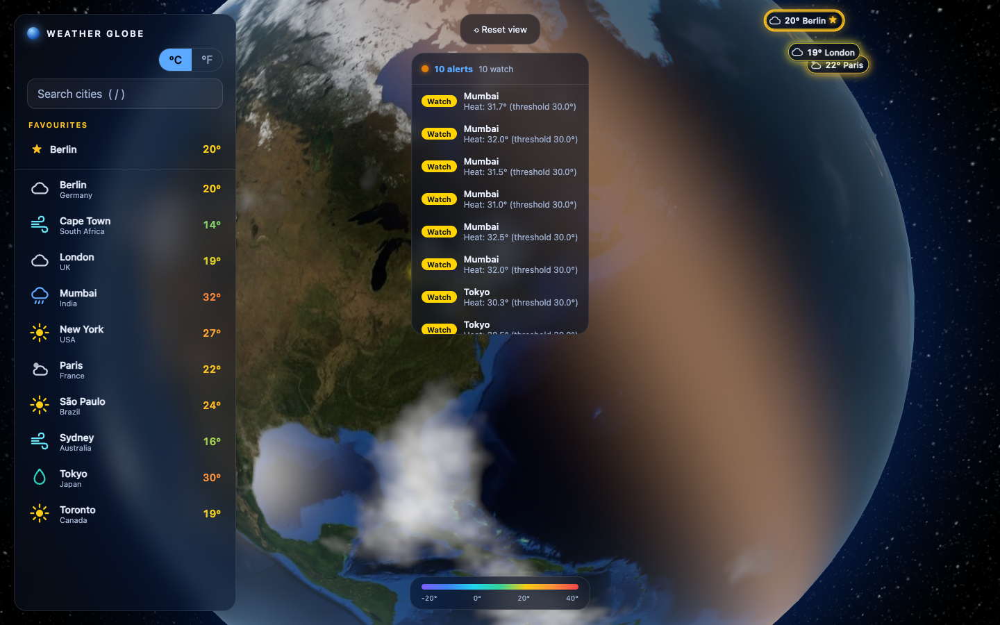

# SDD Workshop — Simple Weather API

A complete Rust starter project for an SDD workshop. It provides a small,
working Weather API that participants can run, explore, and extend using their
preferred Spec-Driven Development workflow.



## Tech Stack

- Rust (stable, 2024 edition)
- Axum for HTTP routing
- SQLx with SQLite for async database access
- Tokio runtime
- Serde for JSON
- utoipa and Swagger UI for OpenAPI documentation

## Prerequisites

- Rust stable toolchain (`rustc` and `cargo`)
- A C toolchain may be required to build SQLite dependencies on some platforms

## Build and Run

```bash
cargo run
```

The application starts on `http://localhost:8080` and creates `weather.db` in
the current directory. The first run applies the database migration and seeds
sample records automatically.

Useful commands:

```bash
cargo test
cargo fmt --check
cargo clippy --all-targets --all-features -- -D warnings
```

Set `PORT` to listen on a different port (default `8080`):

```bash
PORT=8081 cargo run
```

Set `DATABASE_URL` to use a different SQLite file:

```bash
DATABASE_URL=sqlite://./weather.db cargo run
```

On PowerShell:

```powershell
$env:DATABASE_URL = "sqlite://./weather.db"
cargo run
```

## API Documentation

Swagger UI: `http://localhost:8080/swagger-ui.html`  
OpenAPI JSON: `http://localhost:8080/v3/api-docs`

### Endpoints

| Method | Endpoint | Description |
| --- | --- | --- |
| GET | `/api/weather` | List all weather records |
| GET | `/api/weather?city=London` | List weather records filtered by city, case-insensitively |
| GET | `/api/weather/{id}` | Get a single weather record by ID |
| POST | `/api/weather` | Create a new weather record |
| DELETE | `/api/weather/{id}` | Delete a weather record by ID |
| GET | `/api/alerts` | Active weather alerts from current records and forecasts |
| GET | `/api/weather/forecast/{city}` | 5-day forecast (today through today + 4, UTC dates), city case-insensitive |
| GET | `/api/favourites` | List favourite cities (newest first) with each city's latest weather |
| POST | `/api/favourites` | Favourite a city (`{"city":"London"}`): 201 created, 200 already a favourite |
| DELETE | `/api/favourites/{city}` | Remove a favourite (204, or 404 if not a favourite), city case-insensitive |

The forecast data is seeded and static; only the dates roll forward. Unknown
cities return 404 and a blank city returns 400.

Example: `GET /api/weather/forecast/london`

```json
[{"date":"2026-10-30","highTemperatureCelsius":19.0,"lowTemperatureCelsius":11.0,"conditions":"Cloudy","precipitationChance":40}]
```
(truncated to the first of 5 days)

### Example POST Body

```json
{
  "city": "Madrid",
  "country": "Spain",
  "temperatureCelsius": 29.4,
  "humidity": 35,
  "description": "Sunny",
  "windSpeedKmh": 7.2,
  "recordedAt": "2026-07-17T10:00:00"
}
```

`city` is required. `temperatureCelsius`, when provided, must be between -90
and 60. `humidity`, when provided, must be between 0 and 100. If `recordedAt`
is omitted, the current date and time is used.

Validation and not-found responses use this shape:

```json
{
  "timestamp": "2026-07-17T08:15:30",
  "status": 400,
  "error": "Bad Request",
  "message": "City is required",
  "path": "/api/weather"
}
```

## Seed Data

The SQLite migration creates sample weather records for London, New York,
Tokyo, Sydney, Paris, Berlin, Mumbai, São Paulo, Cape Town, and Toronto. Migration `0002` seeds a 5-day forecast template for the same cities.

## Testing

The test suite covers HTTP behavior, validation, error responses, and the
SQLite-backed repository using an in-memory database:

```bash
cargo test
```

## Frontend (Weather Globe)

Open `http://localhost:8080/` for an interactive 3D globe. Drag to rotate, scroll or pinch to zoom, and click a pin (or a city in the list) to fly to it and see current conditions plus the 5-day forecast. The UI reads only `GET /api/weather` and `GET /api/weather/forecast/{city}`; it refreshes every 60 seconds and supports °C/°F, search (`/`), and reduced-motion preferences.



- **No build step**: static HTML/CSS/ES modules in `static/` are embedded into the binary (rebuild after editing them).
- **CDN dependencies**: globe.gl 2.46.2 (SRI-pinned) and Earth textures (three-globe 2.45.6) load from `cdn.jsdelivr.net`, so the globe needs internet access; without it the city list still works.
- **City placement**: the API has no coordinates, so cities are matched against a built-in gazetteer (`static/js/gazetteer.js`). Cities not in it appear in the list as "not on globe".
- **Security**: `/` and `/static/*` send a strict Content-Security-Policy (see `src/frontend.rs`); API responses are unchanged. All API text is rendered as text, never as HTML.

### Weather Alerts

`GET /api/alerts` evaluates every city's latest weather record (and its 5-day forecast highs/lows) against the thresholds in the `alert_thresholds` table and returns the active alerts as `[{city, country, type, severity, value, threshold, source, date}]` (`type`: heat, cold, wind, humidity; `severity`: watch, warning, severe; `source`: current, forecast). Defaults: heat >= 30 C, cold <= 0 C, wind >= 40 km/h, humidity >= 85%. Edit the table to tune them. On the globe, alerting cities get a pulsing ring coloured by worst severity (a static ring under reduced motion), the detail panel lists the city's alerts, and the alerts banner flies to a city when an item is clicked. Alerts refresh on the existing 60-second cycle.



## Workshop Challenge

Using the SDD framework of your choice, plan and implement one of these
extensions:

1. Add weather forecasting (5-day forecast endpoint)
2. Add location-based search (latitude/longitude coordinates)
3. Add a weather alerts/notifications system
4. Add historical weather data and trends

## Project Structure

```text
weather-api/
├── migrations/
│   └── 0001_create_weather_records.sql
├── src/
│   ├── db.rs
│   ├── error.rs
│   ├── frontend.rs
│   ├── handlers.rs
│   ├── lib.rs
│   ├── main.rs
│   ├── models.rs
│   ├── repository.rs
│   └── service.rs
├── static/
│   ├── index.html
│   ├── favicon.svg
│   ├── css/app.css
│   └── js/            (main, state, api, gazetteer, weather, sun, dom, globe-scene, ui)
├── tests/
│   ├── api.rs
│   └── frontend.rs
├── Cargo.toml
└── README.md
```

### Favourites

Users can star cities so they can get back to them quickly. Favourites are one global list stored in the SQLite `favourites` table (no users or auth).

- `POST /api/favourites` trims `city` and matches it case-insensitively against weather records: 201 on create, 200 if already a favourite, 404 if the city has no weather records, 400 if `city` is missing, not a string, blank, or longer than 100 characters.
- `GET /api/favourites` returns `[{"city":"London","favouritedAt":"...","weather":{...}|null}]`, where `weather` is the latest record (greatest `recordedAt`, ties by `id`); it is `null` if all of the city's records were deleted.
- `DELETE /api/favourites/{city}` returns 204, 404 if the city is not a favourite, or 400 if blank.
- In the globe UI, the detail panel has a star toggle, the sidebar has a Favourites section that flies to the city when clicked, and favourite pins get a gold ring and star badge (CSS only).

## Parallel AI-DLC Features

Several AI-DLC agents can build features at the same time, one per git worktree. The orchestrator creates each worktree with a git-ignored `.aidlc-feature` marker (feature id, branch, port, base). The agent then follows `.aidlc-rule-details/common/parallel-features.md`, keeping its state, audit log and claims under `aidlc-docs/features/<feature-id>/`.

- `scripts/aidlc-claims-check.sh` compares this feature's claimed files, routes, tables and migrations with every other active worktree.
- `scripts/browser-check.mjs` loads the globe in headless Chrome and fails on JS exceptions, failed requests or literal `null`/`undefined` text (`node scripts/browser-check.mjs http://localhost:8080/`).
- `scripts/aidlc-index.sh` regenerates `aidlc-docs/features/INDEX.md` on `main` after a merge.
