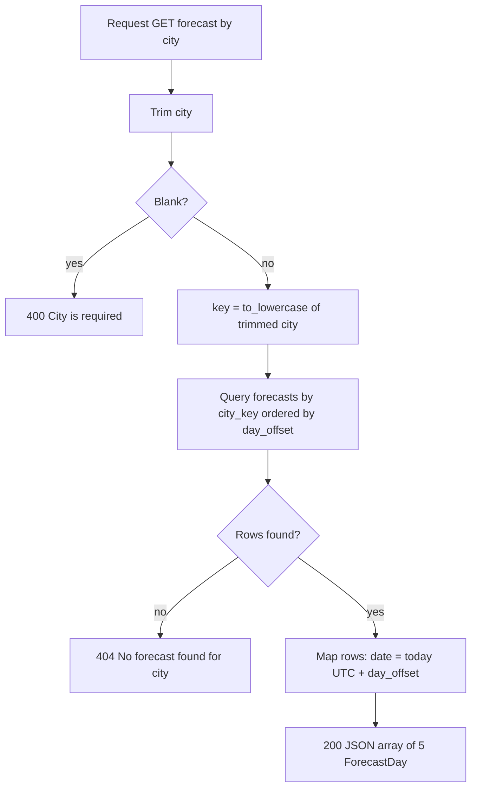

# Business Logic Model — forecast-api

## Flow

Text alternative: trim the city; blank gives 400; otherwise lowercase it and query by `city_key`; no rows gives 404; otherwise map rows to dated entries and return 200.

## Pure functions (unit-testable)
- `normalize_city(&str) -> Result<(display, key), ApiError>` - BR-3, BR-4
- `to_forecast_day(ForecastRow, NaiveDate) -> ForecastDay` - BR-2

## Example (today = 2026-10-30, London, offset 1)
Row (offset 1, 17.5, 10.0, Rainy, 80) -> `{ "date": "2026-10-31", "highTemperatureCelsius": 17.5, "lowTemperatureCelsius": 10.0, "conditions": "Rainy", "precipitationChance": 80 }`

## Seed Data (migration 0002): 10 cities x 5 days
Format per day: high / low (°C), conditions, rain %. Day 0 = today.

| City (`city_key`) | Day 0 | Day 1 | Day 2 | Day 3 | Day 4 |
|---|---|---|---|---|---|
| London (`london`) | 19.0/11.0 Cloudy 40 | 17.5/10.0 Rainy 80 | 18.0/9.5 Overcast 55 | 20.5/11.5 Partly Cloudy 25 | 21.0/12.0 Sunny 10 |
| New York (`new york`) | 27.5/19.0 Sunny 10 | 28.0/20.0 Partly Cloudy 20 | 25.5/18.5 Cloudy 45 | 23.0/17.0 Rainy 75 | 24.5/16.5 Partly Cloudy 30 |
| Tokyo (`tokyo`) | 30.5/25.0 Cloudy 35 | 31.0/25.5 Partly Cloudy 30 | 29.0/24.5 Rainy 70 | 28.5/24.0 Stormy 85 | 30.0/25.0 Sunny 15 |
| Sydney (`sydney`) | 17.0/11.5 Windy 25 | 18.5/12.0 Sunny 10 | 19.5/12.5 Clear 5 | 16.0/11.0 Cloudy 40 | 15.5/10.5 Rainy 65 |
| Paris (`paris`) | 22.5/13.0 Partly Cloudy 20 | 23.5/14.0 Sunny 10 | 21.0/13.5 Cloudy 35 | 19.5/12.0 Rainy 70 | 20.5/11.5 Overcast 45 |
| Berlin (`berlin`) | 20.5/11.0 Overcast 40 | 19.0/10.5 Rainy 65 | 18.0/9.5 Cloudy 45 | 21.0/10.0 Partly Cloudy 20 | 22.5/11.5 Sunny 10 |
| Mumbai (`mumbai`) | 32.0/26.0 Rainy 85 | 31.5/25.5 Stormy 90 | 31.0/25.5 Rainy 80 | 32.5/26.0 Cloudy 55 | 32.0/26.5 Rainy 75 |
| São Paulo (`são paulo`) | 25.0/17.5 Partly Cloudy 30 | 26.5/18.0 Sunny 15 | 24.0/17.0 Cloudy 45 | 22.0/16.0 Rainy 70 | 23.5/16.5 Partly Cloudy 35 |
| Cape Town (`cape town`) | 15.0/8.5 Windy 20 | 16.5/9.0 Sunny 10 | 17.5/9.5 Clear 5 | 14.0/8.0 Cloudy 40 | 13.5/7.5 Rainy 65 |
| Toronto (`toronto`) | 20.0/12.0 Clear 10 | 21.5/13.0 Sunny 10 | 19.0/12.5 Partly Cloudy 25 | 17.0/11.0 Rainy 70 | 18.5/10.5 Cloudy 40 |

## Story Traceability
S1: BR-1,2,11 + seed | S2: BR-3,4 | S3: BR-5,6,7 | S4: BR-8 | S5: BR-9,10,12
