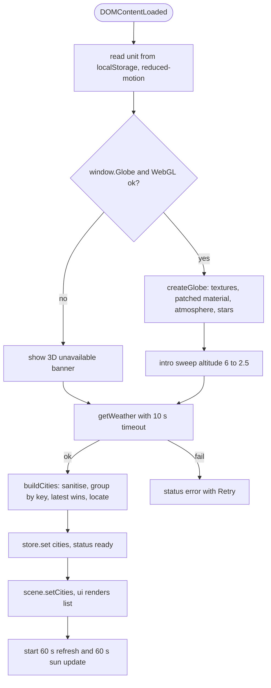
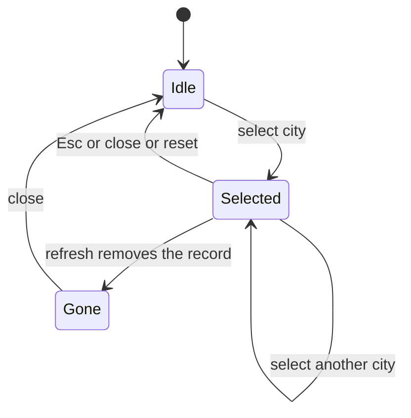

# Business Logic Model — globe-frontend

## 1. Startup sequence



Text alternative: check WebGL/globe.gl (banner if missing), create the scene and intro, fetch weather, build cities (sanitise, group, locate), publish to the store, render pins and list, then start the refresh and sun timers; a fetch failure shows an error state with Retry.

## 2. Build cities (pure)
1. For each record: skip if `city` is not a non-empty string; sanitise city/country/description (BR-1.2).
2. Key = normalize(name)|normalize(country); keep the latest record per key (BR-3.5).
3. `locate()` gives lat/lng or null (BR-3.3); compute `kind` (BR-5), `color` (BR-4), `isDay` (BR-7.4).
4. List order: alphabetical by name, then country; cities not on the globe carry a "not on globe" tag. Filtering by `query` matches a normalised substring of name or country.

## 3. Selection state machine



On entering `Selected`: stop auto-rotate, fly (if on globe), open panel, request forecast, announce. On entering `Idle`: reset view, close panel, restore focus, schedule auto-rotate resume.

## 4. Forecast loading (per key)
```text
select(key): entry = cache[key]
  if entry.state == ready                     -> show
  if entry.state == none and age < 60 s       -> show "none"
  else: cache[key] = loading; abort previous in-flight forecast; getForecast(record.city)
     200 -> sanitise days -> ready
     404 -> none
     other/timeout -> error (retry button -> same path)
  panel renders from cache[key] for the currently selected key only
```

## 5. Refresh cycle
Every 60 s while visible: `getWeather()`; on success rebuild cities, keep selection by key, diff pins (add/update/remove) without moving the camera; update `lastUpdated`; clear `stale`. On failure set `stale` (BR-10.2). On `visibilitychange` to visible, refresh immediately if the last success is older than 60 s.

## 6. Render pipeline of the globe (per frame, GPU)
1. Base: Phong material from the library (day texture = blue marble, bump = topology).
2. Patched fragment (injected after the base colour is computed):
   `d = dot(N_world, uSunDir)`; `dayW = smoothstep(-0.10, 0.20, d)`; `nightW = (1 - smoothstep(-0.20, 0.05, d)) * 1.4`;
   `color = mix(nightLights * nightW, dayColor, dayW)`; add twilight `tint * 0.25 * exp(-(d/0.12)^2)`;
   add ocean specular `spec = pow(max(dot(N, H), 0), 60) * 0.9 * water * dayW`;
   add Fresnel rim `pow(1 - dot(N, V), 3) * mix(0.15, 0.35, dayW) * rimColor`;
   add clouds `c = smoothstep(0.52, 0.78, fbm5(rotate(dir, uTime * 0.002)))`; `color = mix(color, cloudColor * (0.25 + 0.75 * dayW), c * 0.85)`.
3. Library layers on top: atmosphere glow, pins (HTML overlay), rings.
Reduced motion freezes `uTime` and the rotation.

## 7. UI composition (summary)
Header (title, status chip, unit toggle), search and city list (left); detail panel (right) with current conditions and 5 forecast cards; legend (bottom-left); reset view (top-right); live region (visually hidden); banner area. Details in `frontend-components.md`.

## 8. Rust serving logic
```text
GET /              -> 200 index.html bytes + frontend headers
GET /static/{*p}   -> table lookup(p) -> 200 bytes + content type + frontend headers | 404 (plain, with frontend headers)
other routes       -> existing behaviour, no frontend headers
```
No state, no database access, no error paths other than 404.
