# Execution Plan: weather-alerts

## Detailed Analysis Summary

### Transformation Scope
- **Type**: Single-service feature addition (backend + static frontend)
- **Primary changes**: new migration/table, `src/alerts.rs`, one route, OpenAPI entries, `static/js/alerts.js`, small hooks in frontend shared files, tests
- **Related components**: `lib.rs` router/OpenAPI, `main.js`, `ui.js`, `state.js`, `api.js`, `globe-scene.js`, `index.html`, `app.css`

### Change Impact Assessment
- **User-facing**: Yes - rings, banner, detail-panel list
- **Structural**: No - existing handler/service/repository layering reused
- **Data model**: Yes - one new table (`alert_thresholds`) via timestamped migration
- **API**: Yes - additive `GET /api/alerts`
- **NFR**: Yes - reduced motion, XSS (textContent), CSP unchanged, accessibility

### Risk Assessment
- **Risk**: Low-Medium (shared frontend files may also be touched by the parallel feature)
- **Rollback**: Easy (additive; revert branch)
- **Testing complexity**: Moderate

## Workflow Visualization

```mermaid
flowchart TD
    Start(["User Request"])
    WD["Workspace Detection<br/>COMPLETED"]
    RE["Reverse Engineering<br/>SKIP"]
    RA["Requirements Analysis<br/>COMPLETED"]
    US["User Stories<br/>SKIP"]
    WP["Workflow Planning<br/>IN PROGRESS"]
    AD["Application Design<br/>SKIP"]
    UG["Units Generation<br/>SKIP"]
    FD["Functional Design<br/>EXECUTE"]
    NFR["NFR Requirements and Design<br/>SKIP"]
    ID["Infrastructure Design<br/>SKIP"]
    CL["Claims and Overlap Check<br/>EXECUTE"]
    CG["Code Generation<br/>EXECUTE"]
    BT["Build and Test<br/>EXECUTE"]
    End(["Complete"])
    Start --> WD --> RE --> RA --> US --> WP --> AD --> UG --> FD --> NFR --> ID --> CL --> CG --> BT --> End
    style WD fill:#4CAF50,stroke:#1B5E20,stroke-width:3px,color:#fff
    style RA fill:#4CAF50,stroke:#1B5E20,stroke-width:3px,color:#fff
    style WP fill:#4CAF50,stroke:#1B5E20,stroke-width:3px,color:#fff
    style CG fill:#4CAF50,stroke:#1B5E20,stroke-width:3px,color:#fff
    style BT fill:#4CAF50,stroke:#1B5E20,stroke-width:3px,color:#fff
    style CL fill:#4CAF50,stroke:#1B5E20,stroke-width:3px,color:#fff
    style FD fill:#FFA726,stroke:#E65100,stroke-width:3px,stroke-dasharray: 5 5,color:#000
    style RE fill:#BDBDBD,stroke:#424242,stroke-width:2px,stroke-dasharray: 5 5,color:#000
    style US fill:#BDBDBD,stroke:#424242,stroke-width:2px,stroke-dasharray: 5 5,color:#000
    style AD fill:#BDBDBD,stroke:#424242,stroke-width:2px,stroke-dasharray: 5 5,color:#000
    style UG fill:#BDBDBD,stroke:#424242,stroke-width:2px,stroke-dasharray: 5 5,color:#000
    style NFR fill:#BDBDBD,stroke:#424242,stroke-width:2px,stroke-dasharray: 5 5,color:#000
    style ID fill:#BDBDBD,stroke:#424242,stroke-width:2px,stroke-dasharray: 5 5,color:#000
    linkStyle default stroke:#333,stroke-width:2px
```

Text alternative: Workspace Detection, Requirements Analysis, Workflow Planning, Functional Design, Claims Check, Code Generation and Build and Test run in order. Reverse Engineering, User Stories, Application Design, Units Generation, NFR Requirements/Design and Infrastructure Design are skipped.

## Phases to Execute

### INCEPTION
- [x] Workspace Detection (COMPLETED)
- [x] Reverse Engineering (SKIP - parallel mode, delta recorded)
- [x] Requirements Analysis (COMPLETED)
- [ ] User Stories - SKIP. Rationale: single persona (globe viewer); acceptance criteria already explicit in requirements.
- [ ] Workflow Planning (IN PROGRESS)
- [ ] Application Design - SKIP. Rationale: no new architectural components; reuses handler/service/repository and the existing frontend module pattern.
- [ ] Units Generation - SKIP. Rationale: single unit `weather-alerts`; backend and UI are small and coupled by the response contract.

### CONSTRUCTION (single unit `weather-alerts`)
- [ ] Functional Design - EXECUTE. Rationale: severity tiers, forecast date mapping, latest-record selection, ordering and UI ring/banner state rules need precise definition before coding. Compact; defaults pre-filled.
- [ ] NFR Requirements / NFR Design - SKIP. Rationale: NFRs (reduced motion, XSS, CSP, a11y, constant query count) are already in requirements and verified by tests.
- [ ] Infrastructure Design - SKIP. Rationale: no infra change; SQLite migration only.
- [ ] Claims + overlap check - EXECUTE (mandatory; after plan approval and again before Code Generation).
- [ ] Code Generation - EXECUTE (checkbox plan with a `## Coordination` section for shared files)
- [ ] Build and Test - EXECUTE (strengthened parallel gate: commit, rebase on `main`, fmt/clippy/test, curl on port 8082)

### OPERATIONS
- [ ] Operations - PLACEHOLDER

## Code Generation Outline
1. Migration `migrations/<UTC ts>_create_alert_thresholds.sql` with seeds.
2. `src/alerts.rs`: models, pure evaluator with unit tests, queries (thresholds, latest record per city, forecasts), handler, route.
3. `src/lib.rs`: `mod alerts;`, OpenAPI path/schema entries, appended route.
4. Frontend: `static/js/alerts.js` (grouping/severity helpers, banner and panel rendering via textContent), small hooks in `api.js`, `state.js`, `main.js` (alerts fetched inside the existing 60s timer/visibility handler), `ui.js`, `globe-scene.js` (rings), `index.html`, `app.css` (reduced-motion).
5. Tests: `tests/alerts.rs`, frontend tests, README `### Weather Alerts` subsection.

## Success Criteria
- **Primary goal**: dangerous weather visible on the globe and queryable via `GET /api/alerts`.
- **Deliverables**: migration, endpoint, OpenAPI docs, globe UI, tests, README section.
- **Quality gates**: `cargo fmt --check`, `cargo clippy --all-targets --all-features -- -D warnings`, full `cargo test`, curl check on port 8082, rebase onto `main`.
