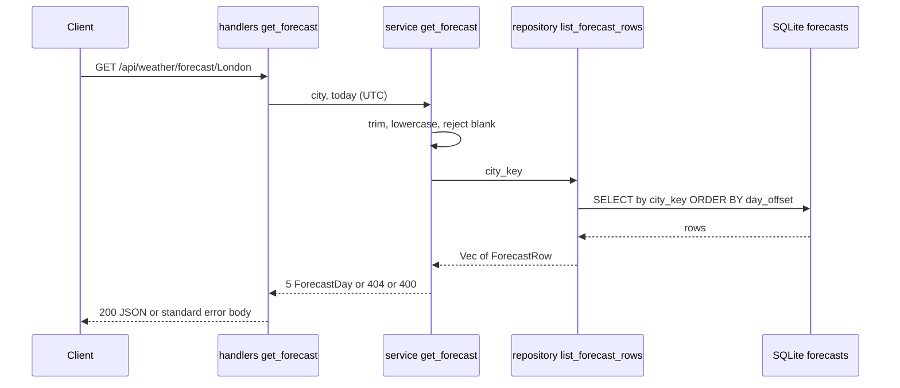

# Component Dependencies

## Dependency Matrix
| Component | Depends on |
|---|---|
| handlers::get_forecast | service, error, models |
| service::get_forecast | repository, error, models |
| repository::list_forecast_rows | models, SqlitePool, `forecasts` table |
| lib.rs | handlers, models (OpenAPI) |
| migration 0002 | none (independent of `weather_records`) |

No new external crates. Existing weather-record code is not touched, so there is no coupling to it (separate table, no foreign key).

## Communication Pattern
Synchronous in-process calls: handler -> service -> repository -> SQLite.

## Data Flow

Text alternative: client calls the handler; the handler passes the city and today's date to the service; the service normalises the city and asks the repository for rows; the repository queries SQLite by `city_key`; the service maps the rows to dated entries or returns a 400/404 error.
