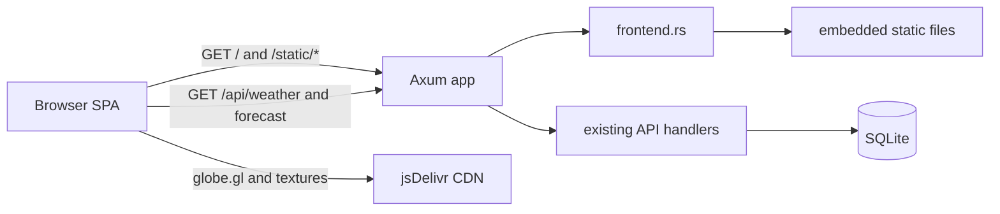
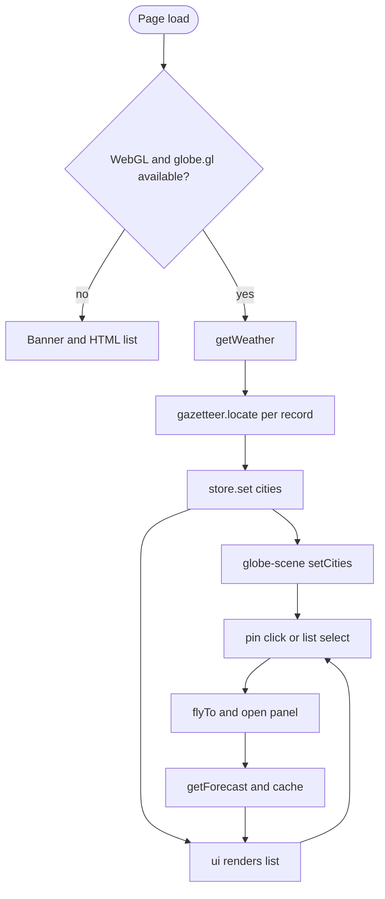

# Component Dependencies — Globe Frontend (Cycle 2)

## Dependency Matrix (row depends on column)

| Component | state | api | gazetteer | weather | sun | dom | globe-scene | ui | CDN globe.gl |
|---|---|---|---|---|---|---|---|---|---|
| main.js | X | X | X | | | | X | X | |
| state.js | | | | | | | | | |
| api.js | | | | | | | | | |
| gazetteer.js | | | | | | | | | |
| weather.js | | | | | | | | | |
| sun.js | | | | | | | | | |
| dom.js | | | | | | | | | |
| globe-scene.js | | | | X | X | X | | | X |
| ui.js | X | | | X | | X | | | |

Rust: `lib.rs` depends on `frontend.rs`; `frontend.rs` depends on `static/**` (compile-time embed). `frontend.rs` has no dependency on `handlers`, `service`, `repository` or the database.

## Communication Patterns
- `main.js` is the only orchestrator: it calls `api.js`, writes to the store, and calls `globe-scene.js` methods.
- `ui.js` subscribes to the store and emits user intent through the `actions` object; `globe-scene.js` reports interaction through callbacks (`onSelect`, `onHover`). Neither calls `api.js`.
- `weather.js`, `sun.js`, `gazetteer.js` are pure (no DOM, no network).
- Browser to server: `GET /`, `GET /static/*`, `GET /api/weather`, `GET /api/weather/forecast/{city}` only.
- Browser to CDN: one script and several texture images from `cdn.jsdelivr.net`.

## Data Flow

Text alternative: the browser loads the page and scripts from Axum (`frontend.rs` serving embedded files), fetches weather and forecast data from the unchanged API handlers (backed by SQLite), and loads globe.gl and textures from the jsDelivr CDN.

Text alternative: on page load the app checks WebGL and globe.gl; if unavailable it shows a banner and an HTML list; otherwise it fetches weather, locates cities, updates the store, renders the globe and list, and on selection flies to the city, opens the panel and loads/caches the forecast.
