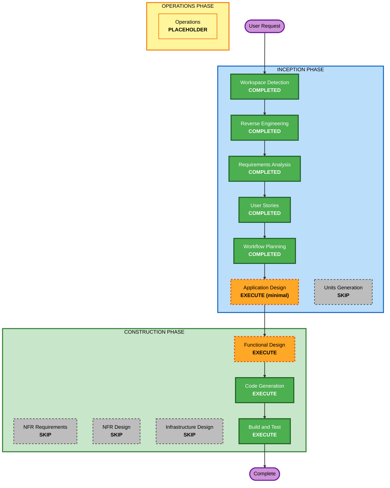

# Execution Plan

## Detailed Analysis Summary

### Transformation Scope (Brownfield Only)
- **Transformation Type**: Single component (additive feature)
- **Primary Changes**: New `forecasts` table (migration `0002`), forecast model, repository query, service logic, handler, route and OpenAPI registration in the existing crate; new tests; README update.
- **Related Components**: None (no infra, no shared packages, no client libs in this repo). Downstream consumers (Dashboard, Mobile, partners) are unaffected until they adopt the endpoint.

### Change Impact Assessment
- **User-facing changes**: Yes - new read-only endpoint `GET /api/weather/forecast/{city}`
- **Structural changes**: No - same layers and modules
- **Data model changes**: Yes - new `forecasts` table; `weather_records` unchanged
- **API changes**: Yes, additive only; no existing contract changes
- **NFR impact**: Minimal - single indexed query, target < 200 ms p95

### Component Relationships
- **Primary Component**: sdd-workshop-weather-api (modify: models, repository, service, handlers, lib; add migration 0002; tests; README)
- **Infrastructure / Shared / Supporting**: none
- **Dependent Components**: Dashboard, Mobile, partner clients (additive, no change required)

| Component | Change Type | Reason | Priority |
|---|---|---|---|
| src/models.rs | Minor | new `ForecastDay` schema | Critical |
| src/repository.rs | Minor | forecast query | Critical |
| src/service.rs | Minor | city validation, date calculation, 404 | Critical |
| src/handlers.rs | Minor | new handler + utoipa path | Critical |
| src/lib.rs | Minor | route + ApiDoc | Critical |
| migrations/0002_*.sql | New | table + seed + CHECKs | Critical |
| tests/api.rs and unit tests | Minor | S1-S5 coverage | Critical |
| README.md | Minor | docs | Important |

### Risk Assessment
- **Risk Level**: Low
- **Rollback Complexity**: Easy (revert commit; a dropped-table down-migration is not needed for a dev SQLite DB, but note `weather.db` will have 0002 applied after a local run)
- **Testing Complexity**: Simple

## Workflow Visualization

Text alternative: Workspace Detection -> Reverse Engineering -> Requirements -> User Stories -> Workflow Planning -> Application Design (minimal) -> Functional Design -> Code Generation -> Build and Test. Skipped: Units Generation, NFR Requirements, NFR Design, Infrastructure Design.

## Phases to Execute

### INCEPTION PHASE
- [x] Workspace Detection (COMPLETED)
- [x] Reverse Engineering (COMPLETED)
- [x] Requirements Analysis (COMPLETED)
- [x] User Stories (COMPLETED)
- [x] Workflow Planning (COMPLETED - approved with Application Design added)
- [ ] Application Design - EXECUTE (minimal depth) - *added at user request*
  - **Rationale**: The feature adds new types and methods in models/repository/service/handlers; capture signatures and layering before Functional Design.
- [ ] Units Generation - SKIP
  - **Rationale**: One cohesive unit of work (single crate, single endpoint). Treated as one unit named `forecast-api`.

### CONSTRUCTION PHASE (unit: forecast-api)
- [ ] Functional Design - EXECUTE
  - **Rationale**: New schema/data model and business rules (rolling dates, city normalisation, error semantics, seed values) are worth pinning down before coding.
- [ ] NFR Requirements - SKIP
  - **Rationale**: Tech stack fixed; NFRs already in requirements.md (NFR-1..6); security/resiliency/PBT extensions opted out.
- [ ] NFR Design - SKIP
  - **Rationale**: No NFR requirements stage; no new patterns needed.
- [ ] Infrastructure Design - SKIP
  - **Rationale**: No infrastructure changes (same service and SQLite DB).
- [ ] Code Generation - EXECUTE (ALWAYS)
  - **Rationale**: Implementation planning and code generation.
- [ ] Build and Test - EXECUTE (ALWAYS)
  - **Rationale**: Run fmt, clippy, tests; write build/test instructions.

### OPERATIONS PHASE
- [ ] Operations - PLACEHOLDER

## Package Change Sequence
Single package. Order within the unit: migration -> models -> repository -> service -> handlers -> lib.rs routing/OpenAPI -> tests -> README.

## Estimated Timeline
- **Total Stages Remaining**: 4 (Application Design, Functional Design, Code Generation, Build and Test)
- **Estimated Duration**: well within Sprint 1 (small additive change)

## Success Criteria
- **Primary Goal**: `GET /api/weather/forecast/{city}` delivers stories S1-S5.
- **Key Deliverables**: migration 0002, Rust code across 5 modules, tests, OpenAPI and README updates, build/test instructions.
- **Quality Gates**: `cargo fmt --check`, `cargo clippy --all-targets --all-features -- -D warnings`, `cargo test` all pass; all pre-existing tests unchanged and passing.
- **Integration Testing**: HTTP-level tests on in-memory SQLite.
