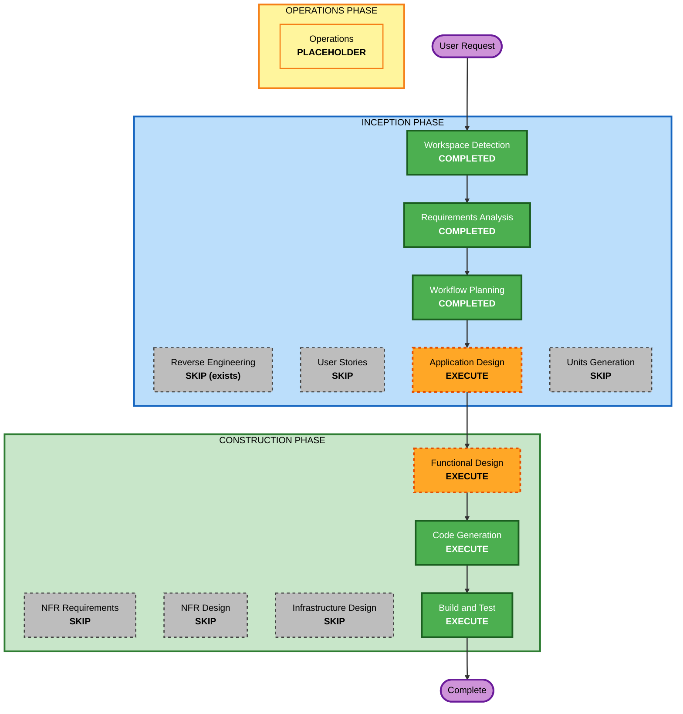

# Execution Plan — Interactive Globe Frontend (Cycle 2)

Cycle 1 plan (`execution-plan.md`) is preserved unchanged.

## Detailed Analysis Summary

### Transformation Scope (Brownfield)
- **Transformation Type**: Single crate, additive: new presentation layer (static SPA) plus a small Rust serving module.
- **Primary Changes**: new `src/frontend.rs` (embedded assets, `/` and `/static/*` routes, CSP header on those routes only), route merge in `src/lib.rs`, new `static/` directory (HTML, CSS, ES modules, gazetteer data), tests, README.
- **Related Components**: none (no infra, shared packages or clients). Existing API, DB and migrations untouched.

### Change Impact Assessment
- **User-facing changes**: Yes - new web UI at `/`.
- **Structural changes**: Minor - one new Rust module and a new `static/` asset tree; existing layering untouched.
- **Data model changes**: No.
- **API changes**: No (existing contracts unchanged; new routes are not part of OpenAPI).
- **NFR impact**: Yes - XSS-safe rendering, CSP, SRI, accessibility, 60 fps target (explicit requirements NFR-2..7).

### Component Relationships
- **Primary Component**: sdd-workshop-weather-api crate (add `frontend` module; modify `lib.rs`)
- **New Component**: browser SPA (`static/`), consumes `/api/weather` and `/api/weather/forecast/{city}`
- **External Dependencies (runtime, browser-side)**: public CDN (three.js / globe.gl, textures)

| Component | Change Type | Reason | Priority |
|---|---|---|---|
| src/frontend.rs | New | embedded assets, routes, CSP | Critical |
| src/lib.rs | Minor | merge frontend router (before `.with_state`) | Critical |
| static/index.html, css, js modules, gazetteer | New | the SPA | Critical |
| tests/api.rs (or new tests/frontend.rs) | Minor/New | route, content-type, CSP, 404 tests | Critical |
| README.md | Minor | Frontend section, structure | Important |
| src/handlers.rs, service, repository, models, migrations | None | API unchanged | - |

### Risk Assessment
- **Risk Level**: Medium (low backend risk; moderate frontend/CDN/CSP/visual-polish risk, and browser behaviour cannot be unit tested)
- **Rollback Complexity**: Easy (remove the module, route merge and `static/`)
- **Testing Complexity**: Moderate (Rust route tests plus manual/headless-browser smoke check)

## Workflow Visualization

Text alternative: Workspace Detection -> Requirements Analysis -> Workflow Planning -> Application Design -> Functional Design -> Code Generation -> Build and Test -> Operations (placeholder). Skipped: Reverse Engineering (artifacts exist), User Stories, Units Generation, NFR Requirements, NFR Design, Infrastructure Design.

## Phases to Execute

### INCEPTION PHASE
- [x] Workspace Detection (COMPLETED)
- [x] Reverse Engineering (SKIPPED - cycle 1 artifacts exist)
- [x] Requirements Analysis (COMPLETED - approved 2026-10-30T11:36:07Z)
- [x] User Stories (SKIPPED - at user request)
  - **Rationale**: Requirements are specific and carry feature-level detail; single stakeholder.
- [x] Workflow Planning (IN PROGRESS)
- [ ] Application Design - EXECUTE (standard depth) - *kept at user request*
  - **Rationale**: New frontend architecture: module breakdown (API client, gazetteer/geo, weather mapping, globe scene, UI panels, state/refresh), the Rust serving module, data flow and CDN dependency boundaries.
- [ ] Units Generation - SKIP (at user request)
  - **Rationale**: One cohesive unit, named `globe-frontend`.

### CONSTRUCTION PHASE (unit: globe-frontend)
- [ ] Functional Design - EXECUTE - *kept at user request*
  - **Rationale**: Pin down CSP directives and CDN pins/SRI, gazetteer data format and matching rules, temperature colour scale, condition-to-icon mapping, day/night shading math, camera/fly-to behaviour, refresh/error state machine, XSS-safe rendering rules, accessibility and reduced-motion behaviour.
- [ ] NFR Requirements - SKIP (at user request)
  - **Rationale**: NFRs already in requirements (NFR-1..11) and resolved in Functional Design.
- [ ] NFR Design - SKIP (at user request)
- [ ] Infrastructure Design - SKIP (at user request)
  - **Rationale**: No infrastructure change; same binary and port.
- [ ] Code Generation - EXECUTE (ALWAYS)
  - **Rationale**: Part 1 plan then Part 2 generation of Rust module, static assets, tests, README.
- [ ] Build and Test - EXECUTE (ALWAYS)
  - **Rationale**: fmt, clippy, tests, live smoke test, headless-browser screenshot if available, CDN/SRI verification.

### OPERATIONS PHASE
- [ ] Operations - PLACEHOLDER

## Package Change Sequence
Single crate. Order: static assets (data, logic modules, scene, UI, HTML/CSS) -> `src/frontend.rs` (embed, routes, CSP) -> `lib.rs` merge -> Rust tests -> README -> live and browser verification.

## Estimated Timeline
- **Stages Remaining**: 4 (Application Design, Functional Design, Code Generation, Build and Test)
- **Duration**: largest effort is in the visual/UX implementation and in verifying it renders correctly.

## Success Criteria
- **Primary Goal**: a visually impressive, interactive globe at `/` showing live weather and forecasts from the existing API.
- **Key Deliverables**: `src/frontend.rs`, `static/` SPA, tests, README section, design and build/test docs.
- **Quality Gates**: `cargo fmt --check`, `cargo clippy --all-targets --all-features -- -D warnings`, `cargo test` pass; all 21 pre-existing tests unchanged and passing; XSS-safe rendering and CSP verified.
- **Integration Testing**: HTTP-level tests of the frontend routes; manual/headless browser smoke test.
