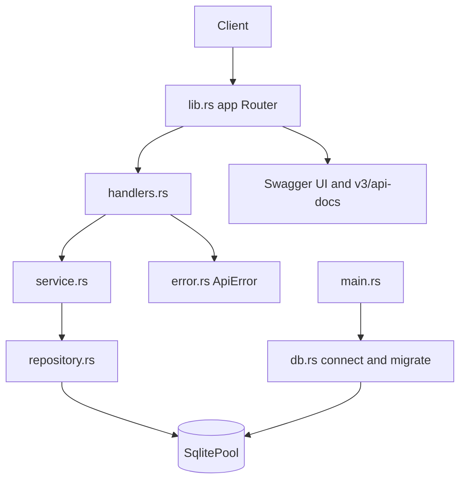
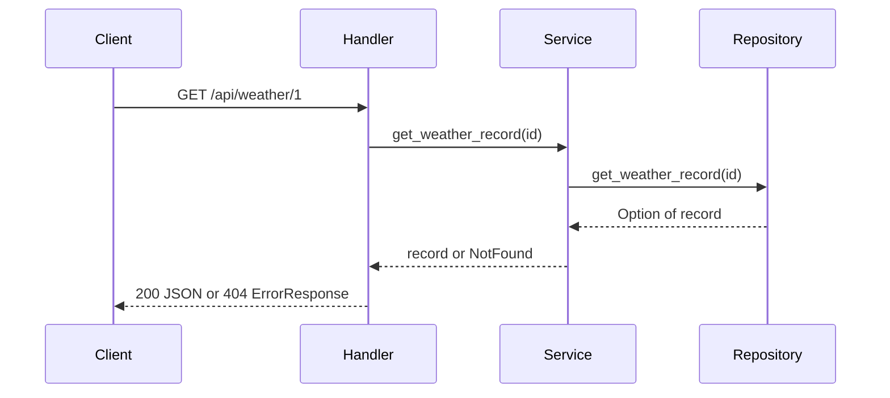

# System Architecture

## System Overview
Single Rust service (Axum) with a layered structure: handlers -> service -> repository -> SQLite (SQLx). Unauthenticated. Migrations run at startup via `sqlx::migrate!`.

## Architecture Diagram

## Component Descriptions
- **main.rs** - tracing init, DATABASE_URL (default sqlite://weather.db), binds 0.0.0.0:8080.
- **db.rs** - connect (create_if_missing, max 5 connections) and migrate.
- **lib.rs** - `app(pool)` router, `ApiDoc` OpenAPI registration (paths and schemas listed explicitly), Swagger UI.
- **handlers.rs** - axum handlers with `#[utoipa::path]`; parse path IDs as String to return a custom 400; attach request path to errors via `with_path`.
- **service.rs** - validation and business rules; maps missing rows to `ApiError::not_found`.
- **repository.rs** - raw `sqlx::query_as` SQL; city filter done in Rust for Unicode-safe case-insensitive matching.
- **models.rs** - `WeatherRecord`, `CreateWeatherRecordRequest`, `ErrorResponse` (camelCase JSON, utoipa `ToSchema`).
- **error.rs** - `ApiError` -> `ErrorResponse {timestamp,status,error,message,path}`.

## Data Flow

## Integration Points
- **External APIs**: none
- **Databases**: SQLite (weather.db; in-memory in tests)
- **Third-party Services**: none

## Infrastructure Components
None defined (no Docker/IaC). Runs via `cargo run`.
