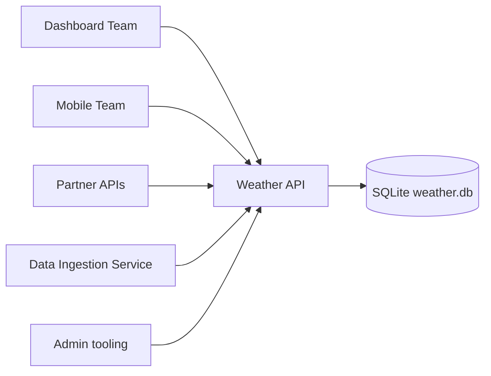

# Business Overview

## Business Context Diagram

## Business Description
- **Business Description**: SkyCast's internal Weather API serves point-in-time weather observations per city to internal teams and 23 external partners. It currently has no forecast capability (see docs/requirements/).
- **Business Transactions**:
  - List weather records, optionally filtered by city (case-insensitive)
  - Get a weather record by ID
  - Create a weather record (ingestion)
  - Delete a weather record (admin)
- **Business Dictionary**: *Weather record* = an observation of a city at `recordedAt`. *Forecast* (proposed) = a predicted day-level outlook for a city.

## Component Level Business Descriptions
### sdd-workshop-weather-api (single crate)
- **Purpose**: Expose weather observations over a REST/JSON API with OpenAPI docs.
- **Responsibilities**: Validation, persistence, standard error format, API documentation.
