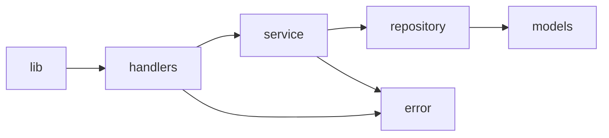

# Code Structure

## Build System
- **Type**: Cargo (edition 2024); crate `sdd-workshop-weather-api` (lib `sdd_workshop_weather_api` + bin)
- **Configuration**: Cargo.toml; migrations/ embedded via `sqlx::migrate!`

## Key Modules

### Existing Files Inventory
- `src/main.rs` - entry point
- `src/lib.rs` - router + OpenAPI doc (**modify**: add route, paths, schemas)
- `src/db.rs` - pool + migrations
- `src/models.rs` - DTOs (**modify**: add forecast models)
- `src/repository.rs` - SQL queries (**modify**)
- `src/service.rs` - business logic (**modify**)
- `src/handlers.rs` - HTTP handlers (**modify**)
- `src/error.rs` - error type (reuse as-is)
- `migrations/0001_create_weather_records.sql` - schema + seed (**add 0002**; do not edit 0001)
- `tests/api.rs` - async HTTP integration tests with in-memory SQLite (**modify**)
- `README.md` - docs (**update endpoint table**)

## Design Patterns
- **Layered handler/service/repository**: thin handlers, rules in service, SQL in repository.
- **Error mapping**: `sqlx::Error` -> 500 via `From`; path injected by handlers (`with_path`).
- **camelCase JSON via serde** `rename_all`.

## Critical Dependencies
axum 0.8, sqlx 0.8 (sqlite), tokio 1, chrono 0.4, serde 1, utoipa 5, utoipa-swagger-ui 9. Dev: tower, http-body-util, serde_json.
