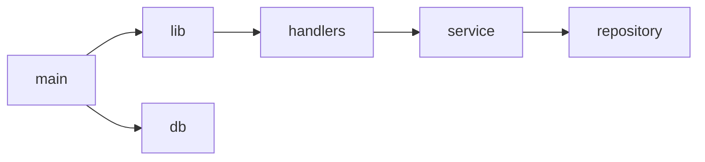

# Dependencies

## Internal Dependencies

Single crate; no inter-package dependencies.

## External Dependencies
- axum 0.8 (routing), sqlx 0.8 (SQLite, migrations), tokio 1 (runtime), chrono 0.4 (time), serde 1 (JSON), utoipa 5 + swagger-ui 9 (docs), tracing/tracing-subscriber (logging). Licenses: MIT/Apache-2.0 (typical for these crates; not independently verified).
- Dev: tower 0.5, http-body-util 0.1, serde_json 1.
- No new dependencies are expected for the forecast feature.
